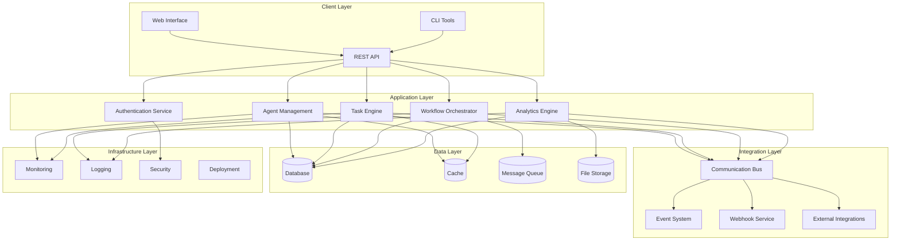
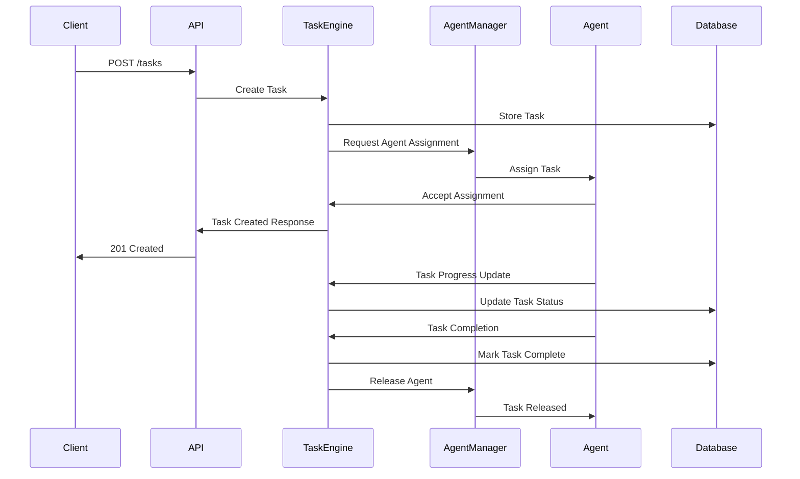

# Architecture Documentation Directory

## Purpose

The docs/architecture directory contains comprehensive system architecture documentation for SwarmDirector, including system design specifications, architectural patterns, component diagrams, and technical decision records. This directory serves as the authoritative source for understanding the system's design, structure, and architectural principles.

## Structure

```
docs/architecture/
├── overview.md                  # High-level system architecture overview
├── system_design.md             # Detailed system design specification
├── component_architecture.md    # Component-level architecture documentation
├── data_architecture.md         # Data architecture and flow documentation
├── security_architecture.md     # Security architecture and threat model
├── deployment_architecture.md   # Deployment and infrastructure architecture
├── integration_architecture.md  # Integration patterns and external systems
├── performance_architecture.md  # Performance design and optimization
├── scalability_design.md        # Scalability patterns and considerations
├── patterns/                    # Architectural patterns and practices
│   ├── microservices.md         # Microservices architecture patterns
│   ├── event_driven.md          # Event-driven architecture patterns
│   ├── cqrs.md                  # Command Query Responsibility Segregation
│   ├── saga_pattern.md          # Saga pattern for distributed transactions
│   ├── circuit_breaker.md       # Circuit breaker pattern implementation
│   └── observer_pattern.md      # Observer pattern for event handling
├── components/                  # Individual component documentation
│   ├── agent_system.md          # Agent system architecture
│   ├── task_engine.md           # Task execution engine architecture
│   ├── workflow_orchestrator.md # Workflow orchestration architecture
│   ├── communication_bus.md     # Communication bus architecture
│   ├── analytics_engine.md      # Analytics engine architecture
│   ├── cost_tracking.md         # Cost tracking system architecture
│   └── web_interface.md         # Web interface architecture
├── diagrams/                    # Architecture diagrams and visuals
│   ├── system_overview.mermaid  # High-level system diagram
│   ├── component_diagram.mermaid # Component interaction diagram
│   ├── data_flow.mermaid        # Data flow diagram
│   ├── deployment_diagram.mermaid # Deployment architecture diagram
│   ├── sequence_diagrams/       # Sequence diagrams for key flows
│   │   ├── task_execution.mermaid # Task execution sequence
│   │   ├── agent_communication.mermaid # Agent communication flow
│   │   └── workflow_orchestration.mermaid # Workflow orchestration
│   └── class_diagrams/          # Class and entity diagrams
│       ├── agent_model.mermaid  # Agent model class diagram
│       ├── task_model.mermaid   # Task model class diagram
│       └── workflow_model.mermaid # Workflow model class diagram
├── decisions/                   # Architecture Decision Records (ADRs)
│   ├── 001_agent_framework_selection.md # Agent framework choice
│   ├── 002_database_selection.md # Database technology selection
│   ├── 003_communication_protocol.md # Inter-service communication
│   ├── 004_authentication_strategy.md # Authentication approach
│   ├── 005_caching_strategy.md  # Caching implementation strategy
│   ├── 006_monitoring_approach.md # Monitoring and observability
│   └── 007_deployment_strategy.md # Deployment and DevOps strategy
├── specifications/              # Technical specifications
│   ├── api_specification.md     # API design specification
│   ├── database_specification.md # Database design specification
│   ├── security_specification.md # Security requirements specification
│   ├── performance_specification.md # Performance requirements
│   └── integration_specification.md # Integration requirements
└── reviews/                     # Architecture review documents
    ├── quarterly_review_2025_q2.md # Quarterly architecture review
    ├── security_review_2025_06.md # Security architecture review
    ├── performance_review_2025_06.md # Performance review
    └── scalability_assessment.md # Scalability assessment
```

## Guidelines

### 1. Organization
- **Hierarchical Structure**: Organize documentation from high-level to detailed specifications
- **Pattern Documentation**: Document architectural patterns and their implementations
- **Decision Tracking**: Maintain Architecture Decision Records (ADRs) for major decisions
- **Visual Documentation**: Include diagrams and visual representations

### 2. Naming
- **Descriptive Names**: Use clear, descriptive names for all architecture documents
- **Consistent Format**: Follow consistent naming conventions across all files
- **Version Indicators**: Include version information for specifications
- **Date Stamps**: Include dates in review and decision documents

### 3. Implementation
- **Mermaid Diagrams**: Use Mermaid for creating maintainable diagrams
- **ADR Format**: Follow standard ADR format for decision records
- **Specification Standards**: Use consistent format for technical specifications
- **Review Process**: Implement regular architecture review processes
- **Version Control**: Track changes to architectural decisions and designs

### 4. Documentation
- **Comprehensive Coverage**: Document all major architectural components
- **Decision Rationale**: Document the reasoning behind architectural decisions
- **Trade-offs**: Document trade-offs and alternatives considered
- **Implementation Guidance**: Provide guidance for implementing architectural patterns
- **Review Documentation**: Document architecture review processes and outcomes

## Best Practices

### Architecture Decision Records (ADRs)
```markdown
# ADR-001: Agent Framework Selection

## Status
Accepted

## Context
SwarmDirector requires a robust framework for managing AI agents that can handle:
- Multi-agent coordination
- Task distribution and execution
- Communication between agents
- Integration with various AI models (OpenAI, Anthropic, etc.)
- Scalable agent lifecycle management

We evaluated several options:
1. AutoGen - Microsoft's multi-agent conversation framework
2. LangChain Agents - LangChain's agent framework
3. Custom implementation - Building our own agent framework

## Decision
We will use AutoGen as the primary agent framework for SwarmDirector.

## Rationale
- **Multi-agent Support**: AutoGen is specifically designed for multi-agent scenarios
- **Conversation Management**: Built-in conversation management and coordination
- **Model Integration**: Excellent integration with multiple AI model providers
- **Community Support**: Active development and community support
- **Flexibility**: Allows for custom agent types and behaviors
- **Documentation**: Well-documented with examples and tutorials

## Consequences
### Positive
- Faster development with proven multi-agent patterns
- Built-in conversation management reduces complexity
- Strong integration with AI model providers
- Active community and ongoing development

### Negative
- Dependency on external framework
- Learning curve for team members
- Potential limitations in custom agent behaviors
- Framework updates may require code changes

## Implementation
- Integrate AutoGen as a core dependency
- Create wrapper classes for SwarmDirector-specific agent types
- Implement custom conversation patterns for our use cases
- Establish testing patterns for multi-agent scenarios

## Review Date
2025-09-18 (3 months from decision)
```

### Security
- **Threat Modeling**: Include threat modeling in architecture documentation
- **Security Patterns**: Document security patterns and implementations
- **Access Control**: Document access control and authorization patterns
- **Data Protection**: Document data protection and privacy measures

### Performance
- **Performance Patterns**: Document performance optimization patterns
- **Scalability Design**: Include scalability considerations in all components
- **Monitoring**: Document monitoring and observability architecture
- **Capacity Planning**: Include capacity planning considerations

### Testing
```markdown
# Architecture Testing Strategy

## Component Testing
Each architectural component should have:
- Unit tests for individual functions
- Integration tests for component interactions
- Contract tests for API boundaries
- Performance tests for scalability validation

## System Testing
- End-to-end testing of complete workflows
- Load testing for performance validation
- Chaos engineering for resilience testing
- Security testing for vulnerability assessment

## Architecture Validation
- Architecture fitness functions
- Dependency analysis and validation
- Performance benchmarking
- Security assessment
```

### Documentation Standards
- **Consistent Format**: Use consistent formatting across all architecture documents
- **Visual Standards**: Maintain consistent visual standards for diagrams
- **Review Process**: Implement regular review and update processes
- **Version Control**: Track all changes to architectural documentation

## Examples

### System Overview Diagram


### Component Architecture Documentation
```markdown
# Agent System Architecture

## Overview
The Agent System is responsible for managing the lifecycle, configuration, and execution of AI agents within SwarmDirector. It provides a unified interface for creating, configuring, monitoring, and coordinating multiple AI agents.

## Components

### Agent Manager
- **Responsibility**: Central coordination of all agents
- **Key Functions**:
  - Agent registration and discovery
  - Lifecycle management (create, start, stop, destroy)
  - Health monitoring and status tracking
  - Resource allocation and management

### Agent Factory
- **Responsibility**: Creation and configuration of agent instances
- **Key Functions**:
  - Agent type resolution and instantiation
  - Configuration validation and application
  - Dependency injection and setup
  - Agent capability registration

### Communication Hub
- **Responsibility**: Inter-agent communication coordination
- **Key Functions**:
  - Message routing between agents
  - Conversation management
  - Event broadcasting and subscription
  - Communication protocol abstraction

### Performance Monitor
- **Responsibility**: Agent performance tracking and optimization
- **Key Functions**:
  - Performance metrics collection
  - Resource usage monitoring
  - Performance analysis and reporting
  - Optimization recommendations

## Data Flow
1. Agent creation request received by Agent Manager
2. Agent Factory validates configuration and creates instance
3. Agent registers with Communication Hub
4. Performance Monitor begins tracking agent metrics
5. Agent becomes available for task assignment

## Integration Points
- **Task Engine**: Receives task assignments and execution requests
- **Workflow Orchestrator**: Participates in workflow execution
- **Analytics Engine**: Provides performance and usage data
- **Communication Bus**: Sends and receives system-wide events

## Scalability Considerations
- Horizontal scaling through agent distribution
- Load balancing for agent assignment
- Resource pooling for efficient utilization
- Auto-scaling based on demand patterns

## Security Measures
- Agent authentication and authorization
- Secure communication channels
- Resource access controls
- Audit logging for all agent operations
```

### Sequence Diagram Example


### Performance Specification
```markdown
# Performance Architecture Specification

## Performance Requirements

### Response Time Requirements
- API endpoints: < 200ms for 95th percentile
- Agent task assignment: < 500ms
- Workflow execution initiation: < 1 second
- Analytics query response: < 2 seconds

### Throughput Requirements
- API requests: 1000 requests/second sustained
- Task processing: 100 concurrent tasks
- Agent operations: 50 agents active simultaneously
- Event processing: 10,000 events/second

### Scalability Requirements
- Horizontal scaling to 10x current capacity
- Auto-scaling based on load patterns
- Zero-downtime deployments
- Database scaling to 1TB+ data

## Performance Patterns

### Caching Strategy
- Application-level caching for frequently accessed data
- Database query result caching
- API response caching for read-heavy endpoints
- Distributed caching for multi-instance deployments

### Asynchronous Processing
- Background task processing for long-running operations
- Event-driven architecture for loose coupling
- Message queues for reliable task distribution
- Async/await patterns for non-blocking operations

### Database Optimization
- Proper indexing for query performance
- Connection pooling for efficient resource usage
- Read replicas for read-heavy workloads
- Partitioning for large datasets

## Monitoring and Observability
- Real-time performance metrics collection
- Application performance monitoring (APM)
- Database performance monitoring
- Infrastructure monitoring and alerting
```

## Related Documentation

- [System Design](system_design.md) - Detailed system design specification
- [Component Architecture](component_architecture.md) - Component-level architecture
- [Security Architecture](security_architecture.md) - Security design and threat model
- [Performance Architecture](performance_architecture.md) - Performance design and optimization
- [Deployment Architecture](deployment_architecture.md) - Deployment and infrastructure
- [API Specification](../api/README.md) - API design and documentation
- [Database Schema](../../database/schemas/README.md) - Database architecture and design
